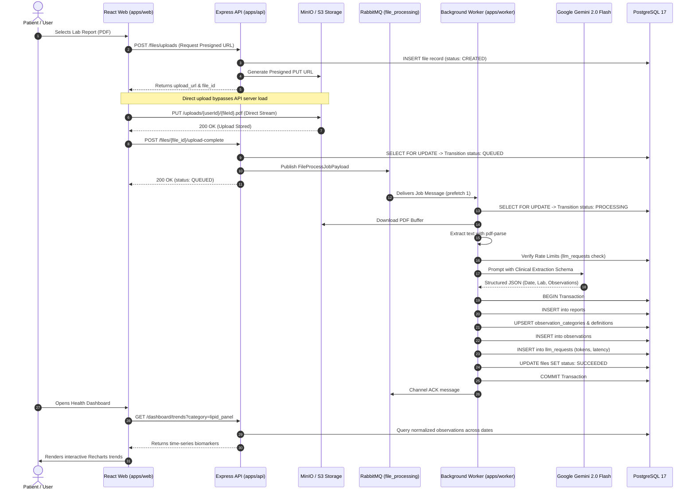
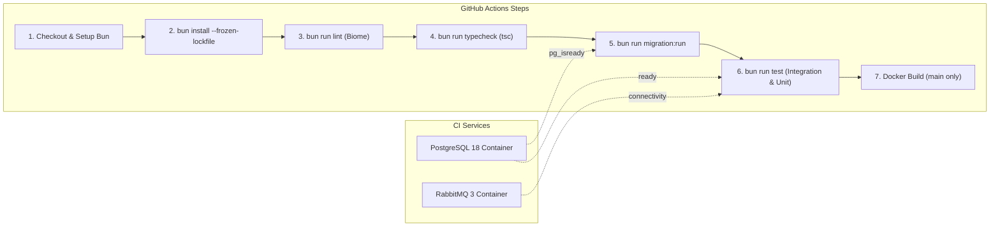

# Health Vitals — Architecture, Dependencies & Testing Strategy

This document provides a comprehensive technical overview of the **Health Vitals** platform, detailing its software architecture, technology dependencies and library choices, and testing strategies.

---

## Table of Contents

1. [System Overview & Architecture](#1-system-overview--architecture)
   - [High-Level Topology](#high-level-topology)
   - [Monorepo Strategy & Architectural Invariants](#monorepo-strategy--architectural-invariants)
   - [Component Breakdown](#component-breakdown)
     - [Edge Reverse Proxy (Traefik)](#edge-reverse-proxy-traefik)
     - [Backend REST API (`apps/api`)](#backend-rest-api-appsapi)
     - [Asynchronous Worker (`apps/worker`)](#asynchronous-worker-appsworker)
     - [Frontend Web Application (`apps/web`)](#frontend-web-application-appsweb)
     - [Database Migrator (`apps/jobs/migrator`)](#database-migrator-appsjobsmigrator)
     - [Shared Contracts Package (`packages/contracts`)](#shared-contracts-package-packagescontracts)
     - [Unified Platform Package (`packages/platform`)](#unified-platform-package-packagesplatform)
     - [Shared Emails Package (`packages/emails`)](#shared-emails-package-packagesemails)
   - [Production Infrastructure & Deployment](#production-infrastructure--deployment)
   - [End-to-End Processing Flow](#end-to-end-processing-flow)
2. [Dependencies & Libraries](#2-dependencies--libraries)
   - [Runtime, Tooling & Build System](#runtime-tooling--build-system)
   - [Backend & Platform Layer](#backend--platform-layer)
   - [Frontend Ecosystem](#frontend-ecosystem)
   - [Architectural Rationale for Key Selections](#architectural-rationale-for-key-selections)
3. [Testing Choices & Strategy](#3-testing-choices--strategy)
   - [Testing Pyramid & Philosophy](#testing-pyramid--philosophy)
   - [Test Runner: `bun test`](#test-runner-bun-test)
   - [Unit Testing](#unit-testing)
   - [Integration Testing](#integration-testing)
   - [AI & LLM Testing Strategy](#ai--llm-testing-strategy)
   - [Frontend Mocking & E2E Testing](#frontend-mocking--e2e-testing)
   - [Continuous Integration & Quality Gates](#continuous-integration--quality-gates)

---

## 1. System Overview & Architecture

**Health Vitals** is a distributed platform designed to ingest unstructured clinical lab reports (PDF format), extract structured biomarker data using Google Gemini generative AI, and present interactive trend visualizations for vital health markers (e.g., lipid panels, glucose metabolism, renal profiles).

### High-Level Topology

```mermaid
graph TD
    Client["User Browser / Client"]
    
    subgraph Ingress ["Edge Layer"]
        Traefik["Traefik v3.6 Reverse Proxy (:80)"]
    end

    subgraph Applications ["Application Tier (Bun Runtime)"]
        Web["Web Frontend (React 19 + Vite 8)"]
        API["Backend API (Express 5 ESM)"]
        Worker["AI Worker (Background Consumer)"]
        Migrator["DB Migrator (Pre-deployment Job)"]
    end

    subgraph SharedPackages ["Shared Workspace Libraries"]
        Contracts["@health-vitals/contracts (Zod + Types)"]
        Platform["@health-vitals/platform (Infra SDK)"]
        Emails["@health-vitals/emails (React Email)"]
    end

    subgraph Infrastructure ["Infrastructure Services (Local Compose / Managed Prod)"]
        Postgres[("PostgreSQL (Local 17 / Neon)")]
        RabbitMQ["RabbitMQ (Local 3 / CloudAMQP)"]
        MinIO[("S3 Storage (Local MinIO / Neon Object Storage)")]
    end

    subgraph ExternalServices ["External Providers"]
        Gemini["LLM Provider (Gemini / Ollama)"]
        Mailer["Email Provider (Resend / SMTP)"]
    end

    Client -->|HTTP / DNS Host Routing| Traefik
    Traefik -->|web.localhost| Web
    Traefik -->|api.localhost| API
    Traefik -->|s3.localhost (Signed URLs)| MinIO
    Traefik -->|rabbitmq.localhost| RabbitMQ

    Web -.->|Uses schemas/DTOs| Contracts
    API -->|Consumes| Contracts
    API -->|Consumes| Platform
    API -->|Renders templates| Emails
    Worker -->|Consumes| Contracts
    Worker -->|Consumes| Platform
    Migrator -->|Consumes| Platform

    Platform -->|Pooled SQL Queries| Postgres
    Platform -->|AMQP Channels| RabbitMQ
    Platform -->|S3 Presigned & Put/Get| MinIO
    Platform -->|API Dispatch| Mailer
    Platform -->|Structured Extraction| Gemini

    API -->|Enqueues Jobs| RabbitMQ
    Worker -->|Consumes Messages| RabbitMQ
    Worker -->|Stores Observations & Metrics| Postgres
    Worker -->|Fetches PDF Buffers| MinIO
    Migrator -->|Applies Schema & Advisory Locks| Postgres
    Migrator -->|Initializes Buckets & CORS| MinIO
```

---

### Monorepo Strategy & Architectural Invariants

The repository is organized as a [Bun Workspace](file:///home/jlevigt/projects/health-vitals/package.json#L5-L9) separating user-facing applications, operational jobs, and shared libraries:

```text
/
├── apps/
│   ├── api/            # REST API (Express 5, Feature-driven)
│   ├── web/            # Frontend SPA (React 19, Vite 8, Tailwind 4)
│   ├── worker/         # RabbitMQ Consumer & LLM Pipeline
│   └── jobs/
│       └── migrator/   # Forward-only DB & S3 Migrations
├── packages/
│   ├── contracts/      # Pure TypeScript DTOs & Zod Schemas (Leaf)
│   ├── emails/         # Branded React Email v6 Templates
│   └── platform/       # Infrastructure Abstraction Layer (DB, Queue, S3, LLM, Mail)
├── tests/
│   └── e2e/            # Full-system End-to-End specifications
├── database/
│   └── migrations/     # Idempotent forward-only SQL migration scripts
└── compose.yml         # Local infrastructure orchestrator
```

The architecture adheres to six non-negotiable invariants:

1. **Strict Dependency Hierarchy (No Circularity, No App Cross-Imports)**:
   - `packages/contracts`: Leaf node with **zero dependencies**. Houses pure types and Zod schemas.
   - `packages/platform`: Encapsulates all external I/O (database, queue, storage, logging, mail, LLM). Depends exclusively on `contracts`.
   - `apps/*`: Application roots acting as dependency injection contexts. Apps consume `packages/*` but **must never import from each other**.
2. **Strict Public API Boundary**:
   - Workspaces must only consume public exports declared in [`packages/contracts/src/index.ts`](file:///home/jlevigt/projects/health-vitals/packages/contracts/src/index.ts) and [`packages/platform/src/index.ts`](file:///home/jlevigt/projects/health-vitals/packages/platform/src/index.ts). Internal package files remain private.
3. **Validation-First Invariant**:
   - Every HTTP endpoint request body, query string, and background queue payload is validated through a Zod schema from `@health-vitals/contracts` before reaching any feature logic.
4. **No Direct Database Access in Business Logic**:
   - Feature services and job handlers never create raw connections or execute unmanaged database pools. They consume the pooled [`Database`](file:///home/jlevigt/projects/health-vitals/packages/platform/src/db/interface.ts) abstraction provided by `@health-vitals/platform`.
5. **Fail-Fast Environment Parity**:
   - Environment variables are validated at startup against a strict Zod schema in [`env.ts`](file:///home/jlevigt/projects/health-vitals/packages/platform/src/config/env.ts). If any required configuration is missing or malformed, the process terminates immediately.
6. **Stateless Applications & Forward-Only Database Migrations**:
   - Applications maintain no local state and output structured JSON logs to `stdout`. Database schema changes are forward-only, executed by [`apps/jobs/migrator`](file:///home/jlevigt/projects/health-vitals/apps/jobs/migrator/src/index.ts) with distributed advisory locks before application rollout.

---

### Component Breakdown

#### Edge Reverse Proxy (Traefik)
- Configured in [`compose.yml`](file:///home/jlevigt/projects/health-vitals/compose.yml#L9-L24) using `traefik:v3.6`.
- Binds to host port `80` and uses Docker socket provider discovery.
- Host-based domain routing:
  - `web.localhost` -> React Web frontend (`apps/web`).
  - `api.localhost` -> Express REST API (`apps/api`).
  - `s3.localhost` & `console.s3.localhost` -> MinIO S3 API & Web Console.
  - `rabbitmq.localhost` -> RabbitMQ Management dashboard.

#### Backend REST API (`apps/api`)
- **Runtime**: Bun executing native TypeScript with [Express 5](file:///home/jlevigt/projects/health-vitals/apps/api/package.json#L15).
- **Vertical Slice / Feature-Driven Structure**: Instead of grouping code by technical layer (controllers, services, repositories), code is organized by business feature in [`apps/api/src/features/`](file:///home/jlevigt/projects/health-vitals/apps/api/src/features/):
  - `auth/`: User registration, email verification, login, JWT refresh, password recovery.
  - `files/`: Presigned upload URL generation, upload confirmation, file listing.
  - `reports/`: Extracted clinical reports listing and observation retrieval.
  - `dashboard/`: Time-series biomarker aggregation for trend visualizations.
  - `health/`: Deep multi-dependency health checking (`/health`).
- **Dependency Injection**: Dependencies (database pool, logger, S3 storage client, queue connection, mail provider) are instantiated in [`apps/api/src/container.ts`](file:///home/jlevigt/projects/health-vitals/apps/api/src/container.ts) and injected into feature services and controllers.
- **Authentication & Security Architecture**:
  - **Password Security**: Uses [Argon2id](file:///home/jlevigt/projects/health-vitals/apps/api/package.json#L12) via `argon2`, providing memory-hard cryptographic protection against GPU-accelerated hash cracking.
  - **Dual-Token Pattern**:
    - Short-lived Access Token: Signed JSON Web Token (JWT) sent via `Authorization: Bearer <token>` headers.
    - Long-lived Refresh Token: Cryptographically secure random token stored as a SHA-256 hash in the database (`sessions` table) and passed to the client inside a secure, `HttpOnly`, `SameSite=Strict` cookie.
  - **Email Verification & Recovery**: Nonce tokens stored as SHA-256 hashes in `email_verifications` with strict expiration policies.
- **Deep Health Probes**:
  - The [`/health`](file:///home/jlevigt/projects/health-vitals/apps/api/src/features/health/controller.ts) route verifies live database connectivity (`SELECT 1`), RabbitMQ channel status, and S3 connectivity. If any critical component fails, it returns `503 Service Unavailable`.
- **Centralized Error Handling**:
  - Custom [`AppError`](file:///home/jlevigt/projects/health-vitals/packages/platform/src/errors/app.error.ts) hierarchy (`NotFoundError`, `ValidationError`, `UnauthorizedError`, `ForbiddenError`, `ConflictError`).
  - The [`errorMiddleware`](file:///home/jlevigt/projects/health-vitals/apps/api/src/middlewares/error.middleware.ts) serializes known application errors with semantic HTTP status codes and masks unexpected errors to prevent internal leakage.

#### Asynchronous Worker (`apps/worker`)
- **Runtime**: Bun executing background consumers with AMQP 0-9-1 connection management via `amqplib`.
- **Queue Consumer Pattern**: Consumes jobs from RabbitMQ queue `file_processing` with `prefetch = 1` for strict rate limiting and backpressure management.
- **Idempotency & Concurrency Control**:
  - Uses PostgreSQL row-level locking: `SELECT id, status FROM files WHERE id = $1 FOR UPDATE`.
  - Only processes files in the `QUEUED` state. If a message is redelivered or already claimed, it cleanly skips execution to avoid duplicate processing.
  - Immediately transitions the file status to `PROCESSING` within a committed transaction before initiating the file download or LLM request.
- **AI Extraction Pipeline**:
  1. **Storage Download**: Retrieves the PDF byte stream from S3 (`health-vitals-uploads` bucket).
  2. **PDF Parsing**: Extracts text via [`extractTextFromPdf`](file:///home/jlevigt/projects/health-vitals/apps/worker/src/consumers/ai-extraction/pdf-extractor.ts) (`pdf-parse`). Requires minimum 50 characters of extracted text to guard against blank scans.
  3. **Rate Limiting Checks**: Checks real-time database metrics against `llm_requests` table (RPM <= 5, RPD <= 20, TPM <= 250,000). Requeues the message if provider rate limits are approached.
  4. **Structured Generative Extraction**: Calls Google Gemini 2.0 Flash with system prompt instructions and strict JSON schema enforcement.
  5. **Transactional Persistence**: Within an atomic database transaction:
     - Stores the clinical report header in `reports`.
     - Dynamically discovers or inserts categories in `observation_categories`.
     - Upserts canonical test definitions in `observation_definitions`.
     - Inserts structured biomarker measurements in `observations` (normalized values, raw units, reference ranges).
  6. **Telemetry & Auditing**: Writes prompt tokens, completion tokens, latency, model name, and error status to `llm_requests`.
  7. **Status Finalization**: Updates file status to `SUCCEEDED` (or `FAILED_RETRYABLE` / `FAILED_TERMINAL` on unrecoverable errors).

#### Frontend Web Application (`apps/web`)
- **Framework & Tooling**: [React 19](file:///home/jlevigt/projects/health-vitals/apps/web/package.json#L19) powered by [Vite 8](file:///home/jlevigt/projects/health-vitals/apps/web/package.json#L35) and [Tailwind CSS 4](file:///home/jlevigt/projects/health-vitals/apps/web/package.json#L33).
- **Direct S3 Presigned Upload Architecture**:
  - Avoids piping large binary files through Node/Express servers.
  - Step 1: Web client asks API for presigned PUT URLs via `POST /files/uploads`.
  - Step 2: Web client performs direct `PUT` request with file binary to MinIO/S3.
  - Step 3: Web client confirms completion with API via `POST /files/:file_id/upload-complete`, triggering background processing.
- **Biomarker Visualizations**: [Recharts](file:///home/jlevigt/projects/health-vitals/apps/web/package.json#L23) powers dynamic graphs illustrating historic vital ranges with custom reference interval shading (e.g., normal cholesterol vs. elevated).
- **Animations & Internationalization**: [GSAP](file:///home/jlevigt/projects/health-vitals/apps/web/package.json#L14) handles SVG-based DNA wave visualizations and transitions; `i18next` / `react-i18next` manage localized UI copy in `src/locales/`.
- **Zero-Backend Mock Mode**: Built-in [Mock Service Worker (MSW)](file:///home/jlevigt/projects/health-vitals/apps/web/package.json#L32) setup (`bun --filter @health-vitals/web dev:mock`), intercepting browser network traffic with synthetic data for full offline development without Docker dependencies.

#### Database Migrator (`apps/jobs/migrator`)
- **Purpose**: Autonomous migration job orchestrated in CI/CD, Docker Compose, and production releases before application services boot.
- **Distributed Concurrency Lock**: Acquires a transaction-scoped PostgreSQL advisory lock (`pg_advisory_xact_lock(1769100000000)`) inside a single `BEGIN ... COMMIT` transaction to guarantee only one migrator instance executes across replicas.
- **Integrity Validation**: Computes SHA-256 checksums of each SQL migration file and verifies them against previously executed records in the `migrations` table, rejecting altered migration files.
- **Storage Provisioning**: Connects to the S3 endpoint, verifies bucket existence (`health-vitals-uploads`), creates it if absent, and automatically configures browser CORS rules for client uploads.

#### Shared Contracts Package (`packages/contracts`)
- Pure TypeScript models and Zod schemas. Also aligned with [`apps/api/openapi.yaml`](file:///home/jlevigt/projects/health-vitals/apps/api/openapi.yaml) as the API contract specification.
- Exports shared types:
  - [`auth.ts`](file:///home/jlevigt/projects/health-vitals/packages/contracts/src/auth.ts): User login, registration, verification, password reset DTOs.
  - [`file.ts`](file:///home/jlevigt/projects/health-vitals/packages/contracts/src/file.ts): `FileStatus` enum (`CREATED`, `QUEUED`, `PROCESSING`, `SUCCEEDED`, `FAILED_RETRYABLE`, `FAILED_TERMINAL`), upload DTOs, queue payload interfaces.
  - [`report.ts`](file:///home/jlevigt/projects/health-vitals/packages/contracts/src/report.ts): Report and Observation DTOs.
  - [`dashboard.ts`](file:///home/jlevigt/projects/health-vitals/packages/contracts/src/dashboard.ts): Time-series biomarker schemas.
  - [`llm.ts`](file:///home/jlevigt/projects/health-vitals/packages/contracts/src/llm.ts): LLM extraction result schema and token usage tracking interfaces.

#### Unified Platform Package (`packages/platform`)
- Infrastructure abstraction layer defining standard contracts and implementations:
  - [`db`](file:///home/jlevigt/projects/health-vitals/packages/platform/src/db/): Connection pool management (`pg.Pool`), query logging, transaction wrappers.
  - [`queue`](file:///home/jlevigt/projects/health-vitals/packages/platform/src/queue/): RabbitMQ connection resilient retry loops, channel asserting, typed job publishing (`publishJob`).
  - [`storage`](file:///home/jlevigt/projects/health-vitals/packages/platform/src/storage/): S3-compatible client wrapper (MinIO locally, Neon Object Storage in production), presigned upload/download URL generator, buffer fetching.
  - [`llm`](file:///home/jlevigt/projects/health-vitals/packages/platform/src/llm/): Swappable [`LLMProvider`](file:///home/jlevigt/projects/health-vitals/packages/platform/src/llm/interface.ts) interface with [`GeminiProvider`](file:///home/jlevigt/projects/health-vitals/packages/platform/src/llm/gemini.ts), [`OllamaProvider`](file:///home/jlevigt/projects/health-vitals/packages/platform/src/llm/ollama.ts), and deterministic [`MockLLMProvider`](file:///home/jlevigt/projects/health-vitals/packages/platform/src/llm/mock.ts).
  - [`mail`](file:///home/jlevigt/projects/health-vitals/packages/platform/src/mail/): Swappable [`MailProvider`](file:///home/jlevigt/projects/health-vitals/packages/platform/src/mail/interface.ts) supporting Resend, Nodemailer, and Mock drivers.
  - [`logger`](file:///home/jlevigt/projects/health-vitals/packages/platform/src/logger/): Structured JSON logging via Pino to `stdout`.
  - [`config/env.ts`](file:///home/jlevigt/projects/health-vitals/packages/platform/src/config/env.ts): Central Zod schema enforcing fail-fast environment configuration.

#### Shared Emails Package (`packages/emails`)
- Branded transactional email templates built with **React Email v6** ([`packages/emails/package.json`](file:///home/jlevigt/projects/health-vitals/packages/emails/package.json)).
- Consumed by `apps/api` for verification and password-recovery emails, with public type declarations in [`src/public.d.ts`](file:///home/jlevigt/projects/health-vitals/packages/emails/src/public.d.ts) and render unit tests in [`src/render.test.ts`](file:///home/jlevigt/projects/health-vitals/packages/emails/src/render.test.ts).

---

### Production Infrastructure & Deployment

Local development uses [`compose.yml`](file:///home/jlevigt/projects/health-vitals/compose.yml) (Traefik, PostgreSQL 17, RabbitMQ, MinIO). Production runs on a zero-VPS **Split Managed Stack** documented in [`infra/README.md`](file:///home/jlevigt/projects/health-vitals/infra/README.md):

- **Frontend:** Vercel (`apps/web`, configured via [`apps/web/vercel.json`](file:///home/jlevigt/projects/health-vitals/apps/web/vercel.json))
- **Database & Object Storage:** Neon PostgreSQL + Neon Object Storage (`health-vitals-uploads` private bucket declared in [`neon.ts`](file:///home/jlevigt/projects/health-vitals/neon.ts))
- **Message Broker:** CloudAMQP (RabbitMQ)
- **Backend Compute:** Fly.io (`apps/api` and `apps/worker` deployed via [`infra/fly/deploy.sh`](file:///home/jlevigt/projects/health-vitals/infra/fly/deploy.sh) using multi-stage Bun Dockerfiles)
- **DNS & Email:** Cloudflare DNS (`binderlex.com`) + Resend transactional email

---

### End-to-End Processing Flow



---

## 2. Dependencies & Libraries

### Runtime, Tooling & Build System

| Package / Tool | Version | Workspace Scope | Architectural Role & Justification |
| :--- | :--- | :--- | :--- |
| **[Bun](https://bun.sh/)** | `^1.3.12` | Root / All | **Primary Runtime & Workspace Runner.** Replaces Node.js, npm, and ts-node. Provides native TypeScript execution without build steps, blazing fast package installation, built-in SQLite/crypto, and a high-performance native test runner. |
| **[@biomejs/biome](https://biomejs.dev/)** | `^2.4.14` | Root Dev | **Formatting & Linting Engine.** Written in Rust; delivers 10x-20x faster static analysis than ESLint and Prettier combined, enforcing consistent formatting across all monorepo workspaces in a single command. |
| **[TypeScript](https://www.typescriptlang.org/)** | `^6.0.3` | All Workspaces | **Type System & Quality Gate.** Configured with strict compiler settings. Enforces the strict "no `any`" policy across contracts, platform abstractions, and feature code. |

---

### Backend & Platform Layer

| Dependency | Version | Location | Architectural Purpose & Selection Rationale |
| :--- | :--- | :--- | :--- |
| **[`express`](https://expressjs.com/)** | `^5.1.0` | `apps/api` | **HTTP Web Framework.** Express 5 natively supports Promises and async route handlers, resolving unhandled promise rejections automatically without requiring custom async wrapper boilerplate. |
| **[`pg`](https://node-postgres.com/)** | `^8.16.3` | `packages/platform`, `apps/jobs/migrator` | **PostgreSQL Client & Connection Pooler.** Battle-tested, zero-overhead driver. Supports client pooling, PostgreSQL advisory locks for migrations, and manual transaction management (`BEGIN` / `FOR UPDATE` / `COMMIT`). |
| **[`amqplib`](https://amqp-node.github.io/amqplib/)** | `^1.0.3` | `packages/platform` | **AMQP 0-9-1 RabbitMQ Client.** Manages message queue topology, channel pooling, prefetch throttling, message acknowledgments (`ack`/`nack`), and durable queue assertions. |
| **[`@aws-sdk/client-s3`](https://aws.amazon.com/sdk-for-javascript/)** | `^3.700.0` | `packages/platform`, `apps/jobs/migrator` | **S3-Compatible Object Storage SDK.** Modular AWS SDK v3 client used to interact with MinIO locally and Neon Object Storage (S3-compatible) in production. Supports bucket initialization and CORS policy configuration. |
| **[`@aws-sdk/s3-request-presigner`](https://www.npmjs.com/package/@aws-sdk/s3-request-presigner)** | `^3.700.0` | `packages/platform` | **Presigned URL Generator.** Generates time-limited, cryptographically signed HTTP PUT/GET URLs, enabling browsers to upload files directly to S3 without consuming API server memory or bandwidth. |
| **[`@google/genai`](https://www.npmjs.com/package/@google/genai)** | `^1.30.0` | `packages/platform`, `apps/worker` | **Google Gemini Generative AI SDK.** Interfaces with `gemini-2.0-flash` for clinical report extraction. Supports structured JSON schema response formatting and token usage metrics. |
| **[`zod`](https://zod.dev/)** | `^4.4.3` | `packages/contracts`, `packages/platform`, `apps/api`, `apps/worker` | **Schema Validation & Static Type Inference.** Acts as the single source of truth for all network contracts, query strings, and environment variables. Automatically derives TypeScript types from schemas (`z.infer`). |
| **[`argon2`](https://www.npmjs.com/package/argon2)** | `^0.44.0` | `apps/api` | **Cryptographic Password Hashing.** Implements the Argon2id algorithm (Password Hashing Competition winner), offering resistance against GPU and ASIC side-channel attacks. |
| **[`jsonwebtoken`](https://www.npmjs.com/package/jsonwebtoken)** | `^9.0.2` | `apps/api` | **JWT Token Minting & Verification.** Creates compact, cryptographically signed Bearer tokens for stateless authentication. |
| **[`pino`](https://getpino.io/)** & **[`pino-http`](https://www.npmjs.com/package/pino-http)** | `^10.2.1` / `^11.0.0` | `packages/platform`, `apps/api` | **High-Speed Structured Logging.** Extremely fast JSON logger with minimal event-loop overhead. Adheres to 12-factor application standards by streaming structured logs to `stdout`. |
| **[`pdf-parse`](https://www.npmjs.com/package/pdf-parse)** | `^2.4.5` | `apps/worker`, `apps/api` | **In-Memory PDF Text Extraction.** Parses binary PDF buffers into text streams without requiring external system dependencies like `pdftotext` or Poppler. |
| **[`resend`](https://resend.com/)** | `^6.8.0` | `packages/platform`, `apps/api` | **Modern Email Delivery API.** Primary cloud transactional email provider with high deliverability rates. |
| **[`nodemailer`](https://nodemailer.com/)** | `^8.0.6` | `packages/platform`, `apps/api` | **SMTP Mail Transport.** Serves as the fallback transport for local SMTP testing and self-hosted environments. |
| **[`cookie-parser`](https://www.npmjs.com/package/cookie-parser)** | `^1.4.7` | `apps/api` | **Cookie Header Parser.** Securely parses HTTP request cookies for HttpOnly refresh token extraction. |
| **[`cors`](https://www.npmjs.com/package/cors)** | `^2.8.5` | `apps/api` | **CORS Middleware.** Configures cross-origin headers, credentials, and allowed origins between the web client and API. |
| **[`uuid`](https://www.npmjs.com/package/uuid)** | `^14.0.0` | `apps/api` | **Unique Identifier Generator.** Generates RFC4122 UUIDs for sessions, tokens, and storage keys. |

---

### Frontend Ecosystem

| Dependency | Version | Location | Architectural Purpose & Selection Rationale |
| :--- | :--- | :--- | :--- |
| **[`react`](https://react.dev/)** & **[`react-dom`](https://react.dev/)** | `^19.2.0` | `apps/web` | **UI Library.** Modern React 19 leveraging enhanced hooks, compiler optimizations, and concurrent rendering features. |
| **[`vite`](https://vite.dev/)** & **[`@vitejs/plugin-react`](https://www.npmjs.com/package/@vitejs/plugin-react)** | `^8.0.10` / `^6.0.1` | `apps/web` | **Build Tool & Dev Server.** Ultra-fast Hot Module Replacement (HMR) and optimized Rollup-based production bundling. |
| **[`tailwindcss`](https://tailwindcss.com/)** & **[`@tailwindcss/vite`](https://www.npmjs.com/package/@tailwindcss/vite)** | `^4.1.18` | `apps/web` | **Utility-First Styling Engine.** Tailwind v4 with the native Vite plugin, delivering zero-configuration CSS builds, lightning-fast compilation, and modern CSS theme variables. |
| **[`react-router-dom`](https://reactrouter.com/)** | `^7.12.0` | `apps/web` | **Client Routing.** Manages client-side navigation, deep-linking, and protected route wrappers. |
| **[`recharts`](https://recharts.org/)** | `^3.6.0` | `apps/web` | **Data Visualization.** Declarative SVG charting library tailored for clinical biomarker trendlines with customizable tooltips, axes, and reference areas. |
| **[`gsap`](https://gsap.com/)** | `^3.14.2` | `apps/web` | **Animation Suite.** High-performance timeline animation engine for visual effects like the DNA double-helix wave loader. |
| **[`lucide-react`](https://lucide.dev/)** | `^1.11.0` | `apps/web` | **Icon System.** Tree-shakeable, clean, and accessible SVG icon library. |
| **[`clsx`](https://www.npmjs.com/package/clsx)** & **[`tailwind-merge`](https://www.npmjs.com/package/tailwind-merge)** | `^2.1.1` / `^3.4.0` | `apps/web` | **Conditional Class Merging.** Safely concatenates and deduplicates Tailwind class strings, resolving style conflicts. |
| **[`msw`](https://mswjs.io/)** | `^2.12.7` | `apps/web` | **Mock Service Worker.** Intercepts HTTP requests at the network layer using Service Workers in the browser, providing offline mock capabilities for standalone frontend development. |

---

### Architectural Rationale for Key Selections

```text
+-----------------------+--------------------------+--------------------------------------------------------+
| Requirement           | Chosen Solution          | Reason Over Alternatives                               |
+-----------------------+--------------------------+--------------------------------------------------------+
| Runtime & Tooling     | Bun (v1.3+)              | 4x faster install than npm/pnpm; native TypeScript;    |
|                       |                          | built-in test runner; single runtime for all services. |
+-----------------------+--------------------------+--------------------------------------------------------+
| Code Quality & Lints  | Biome (v2.4+)            | Sub-second formatting and linting; replaces ESLint &   |
|                       |                          | Prettier without plugins or configuration bloat.       |
+-----------------------+--------------------------+--------------------------------------------------------+
| Contract Validation   | Zod (v4)                 | Seamless type inference; single source of truth for    |
|                       |                          | runtime validation across backend, worker, and client. |
+-----------------------+--------------------------+--------------------------------------------------------+
| Password Security     | Argon2id (argon2)        | Winner of the Password Hashing Competition; far more   |
|                       |                          | resistant to GPU/ASIC attacks than bcrypt or PBKDF2.  |
+-----------------------+--------------------------+--------------------------------------------------------+
| File Upload Pipeline  | Direct S3 Presigned URLs | Eliminates backend memory pressure; files stream       |
|                       |                          | directly from browser to MinIO/S3 object storage.      |
+-----------------------+--------------------------+--------------------------------------------------------+
| Offline Frontend Dev  | Mock Service Worker(MSW) | Network-level interception; UI code makes identical   |
|                       |                          | fetch calls in both mock mode and production mode.     |
+-----------------------+--------------------------+--------------------------------------------------------+
```

---

## 3. Testing Choices & Strategy

### Testing Pyramid & Philosophy

The project follows a **Test Pyramid** strategy designed to maximize execution velocity, provide reliable guarantees against regressions, and minimize maintenance overhead:

```text
       / \
      / E2E \        E2E Tests (Playwright + Native Bun Fetch)
     /-------\       Full-system validation against live Docker stack
    / Integr. \      Integration Tests (Supertest + Real DB & RabbitMQ)
   /-----------\     Route contracts, DB transactions, worker pipelines
  /  Unit Tests \    Unit Tests (Co-located, bun:test, pure functions)
 /---------------\   PDF parsing, Zod schema validation, utility logic
```

1. **Unit Tests**: Focus on pure algorithmic logic, schema parsing, and isolated utility modules. They run in milliseconds and have zero external service dependencies.
2. **Integration Tests**: Verify realistic component interactions using real PostgreSQL and RabbitMQ instances. They test database transactions, cascade deletions, advisory locks, Express middleware, and worker state transitions.
3. **End-to-End (E2E) Tests**: Verify complete user flows from browser interactions (Playwright) through to API calls and queue processing.

---

### Test Runner: `bun test`

All tests across all workspaces are executed using Bun's native test runner (`bun:test`).

**Why `bun test` was chosen over Jest / Vitest**:
- **Zero Configuration & Transpilation**: Bun executes TypeScript directly without `ts-jest`, `babel`, or `esbuild` plugins.
- **Execution Speed**: Test suites run in parallel across CPU cores with near-instant startup times.
- **Jest-Compatible API**: Provides familiar assertion primitives ([`expect`](file:///home/jlevigt/projects/health-vitals/apps/api/tests/integration/auth.test.ts#L1), [`describe`](file:///home/jlevigt/projects/health-vitals/apps/api/tests/integration/auth.test.ts#L8), [`it`](file:///home/jlevigt/projects/health-vitals/apps/api/tests/integration/auth.test.ts#L33), [`beforeAll`](file:///home/jlevigt/projects/health-vitals/apps/api/tests/integration/auth.test.ts#L16), [`afterAll`](file:///home/jlevigt/projects/health-vitals/apps/api/tests/integration/auth.test.ts#L29), [`spyOn`](file:///home/jlevigt/projects/health-vitals/apps/api/tests/integration/auth.test.ts#L19), [`mock`](file:///home/jlevigt/projects/health-vitals/apps/worker/tests/integration/handler.test.ts#L7)).
- **Monorepo-Wide Execution**: The root [`package.json`](file:///home/jlevigt/projects/health-vitals/package.json#L19) runs tests across all workspaces in a single command:
  ```bash
  bun test --env-file=.env tests apps/*/tests apps/jobs/*/tests packages/*/tests apps/*/src apps/jobs/*/src packages/*/src
  ```

---

### Unit Testing

- **Co-location Standard**: Unit tests live directly alongside source files using the `*.unit.test.ts` naming convention (e.g., [`apps/worker/src/consumers/ai-extraction/pdf-extractor.unit.test.ts`](file:///home/jlevigt/projects/health-vitals/apps/worker/src/consumers/ai-extraction/pdf-extractor.unit.test.ts)).
- **Fast Feedback**:
  - Validates PDF text extraction with valid buffers, empty buffers, and corrupted data.
  - Asserts that Zod schemas in [`packages/contracts`](file:///home/jlevigt/projects/health-vitals/packages/contracts/tests/schema.test.ts) properly accept conforming payloads and reject invalid input with structured validation errors.

---

### Integration Testing

Integration tests verify that modular components interact correctly with infrastructure and external services.

#### Express API Testing via Supertest
- **In-Memory Express Invocation**: Uses [`supertest`](file:///home/jlevigt/projects/health-vitals/apps/api/package.json#L41) with [`createApp()`](file:///home/jlevigt/projects/health-vitals/apps/api/src/app.ts#L20) (e.g., [`apps/api/tests/integration/auth.test.ts`](file:///home/jlevigt/projects/health-vitals/apps/api/tests/integration/auth.test.ts) and [`apps/api/tests/integration/upload.test.ts`](file:///home/jlevigt/projects/health-vitals/apps/api/tests/integration/upload.test.ts)).
- **No TCP Port Binding**: Tests run directly against the Express HTTP request listener in memory, executing full middleware stacks (CORS, body parser, cookie parser, JWT authentication, error handling) in milliseconds without port conflicts.
- **Session & Cookie Persistence**: Uses `request.agent(app)` to verify HttpOnly cookie transmission across multi-step flows (registration -> verification -> login -> authenticated requests).

#### Real Infrastructure vs. In-Memory Mocks
- **Choice: Real PostgreSQL & Real RabbitMQ**: Instead of fragile in-memory mock libraries, integration tests execute against real PostgreSQL and RabbitMQ instances (started via `docker compose up -d` locally or GitHub Actions service containers in CI).
- **Benefits**:
  - Catches dialect-specific SQL errors, transaction isolation anomalies, and foreign key constraint violations.
  - Validates row-level locking (`SELECT ... FOR UPDATE`) and advisory locks.
  - Verifies RabbitMQ durable queue declarations, bindings, and message serialization.

#### Test Isolation & Cleanup
- Tests use unique entity identifiers to avoid cross-test contamination:
  ```typescript
  const testEmail = `test_${Date.now()}@example.com`;
  ```
- **Cascading Teardown**: Database cleanup routines take advantage of `ON DELETE CASCADE` constraints: deleting a test user in [`afterAll`](file:///home/jlevigt/projects/health-vitals/apps/api/tests/integration/auth.test.ts#L29-L31) automatically cascades and purges corresponding records in `files`, `reports`, `observations`, and `sessions`.

---

### AI & LLM Testing Strategy

Testing LLM-backed workflows requires balancing determinism and CI execution costs with real-world verification.

#### Dual-Provider Architecture
- The platform defines a generic interface [`LLMProvider`](file:///home/jlevigt/projects/health-vitals/packages/platform/src/llm/interface.ts) in `@health-vitals/platform`.
- **[`MockLLMProvider`](file:///home/jlevigt/projects/health-vitals/packages/platform/src/llm/mock.ts)**:
  - Default provider used in CI and automated integration tests ([`handler.test.ts`](file:///home/jlevigt/projects/health-vitals/apps/worker/tests/integration/handler.test.ts) and [`process-file.test.ts`](file:///home/jlevigt/projects/health-vitals/apps/worker/tests/integration/process-file.test.ts)).
  - Emits predictable, structured medical data with realistic token counts and zero network latency.
  - Prevents test failures caused by external API outages, rate limits, or billing costs.
- **[`GeminiProvider`](file:///home/jlevigt/projects/health-vitals/packages/platform/src/llm/gemini.ts)**:
  - Real Google Gemini implementation calling `gemini-2.0-flash`.
  - **Gated Execution**: Integration tests that call the live Gemini API require an explicit environment flag:
    ```bash
    RUN_LLM_TESTS=true bun test --env-file=../../.env tests/integration/process-file.test.ts
    ```

#### Real PDF Fixture Testing
- The worker test suite includes an actual clinical laboratory report fixture: [`Resultado_LABORATORIO CLEMENTINO FRAGA_70005839058701.pdf`](file:///home/jlevigt/projects/health-vitals/apps/worker/tests/integration/helpers.ts#L169-L172).
- Ensures that real-world multi-page PDFs with tables, headers, and laboratory metadata parse successfully through `pdf-parse` and produce valid biomarker observations.

---

### Frontend Mocking & E2E Testing

#### Mock Service Worker (MSW) in Frontend Development
- Configured in [`apps/web/src/mocks/`](file:///home/jlevigt/projects/health-vitals/apps/web/src/mocks/handlers.ts).
- Enables frontend development without spinning up the backend, database, or queue (`bun run dev:mock`).
- Intercepts browser `fetch` requests at the network layer and responds with typed fixtures matching `@health-vitals/contracts`.
- Ensures the UI code remains completely identical between development, mock mode, and production.

#### End-to-End (E2E) Verification
- Defined in [`tests/e2e/system.e2e.test.ts`](file:///home/jlevigt/projects/health-vitals/tests/e2e/system.e2e.test.ts) (`bun run test:e2e`, gated by `RUN_E2E=true`).
- Runs against a live stack (`docker compose up --build`) using native Bun `fetch` to validate the full system flow from auth and file upload through worker extraction and dashboard retrieval.

---

### Continuous Integration & Quality Gates

The CI pipeline is defined in [`.github/workflows/ci.yml`](file:///home/jlevigt/projects/health-vitals/.github/workflows/ci.yml) and runs on every push and pull request to `main`:



1. **Lint & Format**: `bun run lint` enforces [Biome](https://biomejs.dev/) formatting and lint rules across all workspaces.
2. **Static Typecheck**: `bun run typecheck` validates strict TypeScript compilation (`tsc`) across all apps and packages.
3. **Database Migration Gate**: Runs [`apps/jobs/migrator`](file:///home/jlevigt/projects/health-vitals/apps/jobs/migrator/src/index.ts) against the healthy PostgreSQL service container to ensure all schema migrations apply cleanly.
4. **Automated Test Execution**: Runs the complete test suite (`bun run test`) with real database and message queue connections.
5. **Container Image Verification**: On merge to `main`, builds Docker images for `api`, `worker`, `migrator`, and `web` to prevent deployment build regressions.
6. **Git Workflow & Hooks**: Trunk-Based Development (short-lived feature branches merged via Squash & Merge) with [Conventional Commits](https://www.conventionalcommits.org/) (`feat:`, `fix:`, `refactor:`, `test:`, `chore:`) enforced locally via [`.githooks/commit-msg`](file:///home/jlevigt/projects/health-vitals/.githooks/commit-msg).
