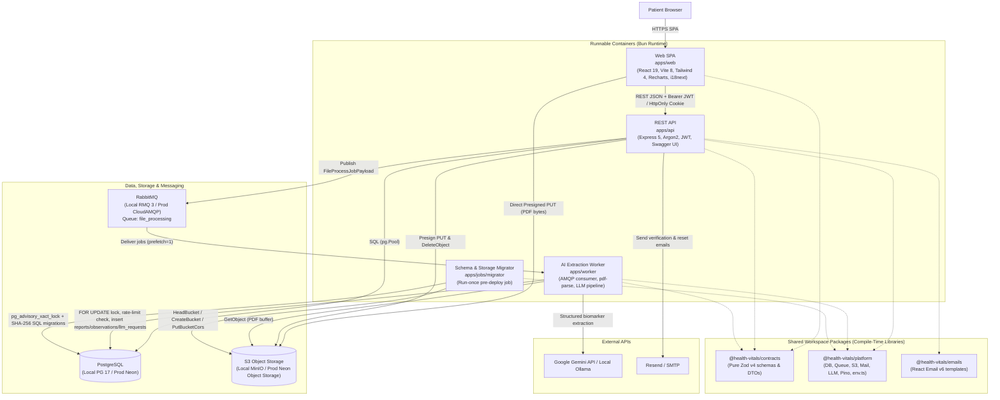
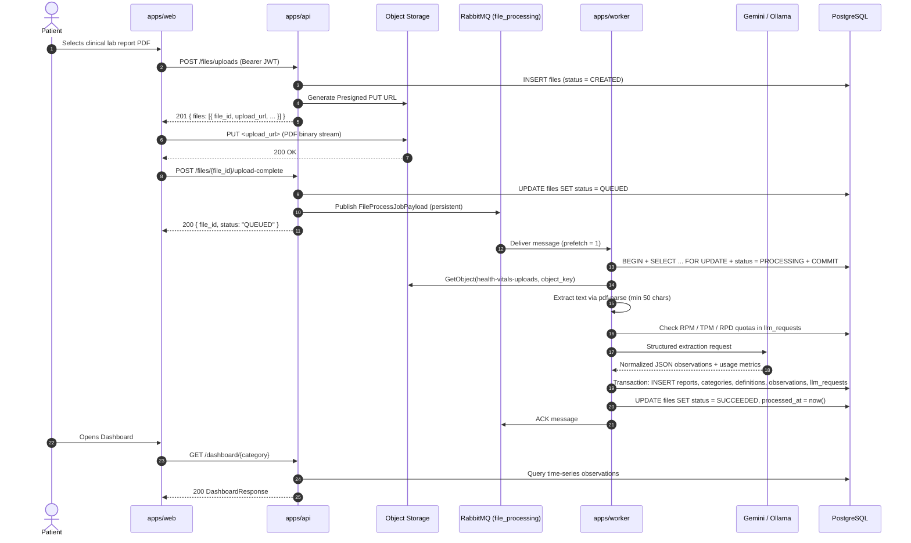

# Containers & Communication Flows (C4 Level 2)

Health Vitals is organized as a Bun Workspace monorepo containing four runnable containers (`apps/*`) and three internal shared packages (`packages/*`).

## Container Diagram

## Container & Package Responsibilities

| Container / Package | Runtime Role | Key Communication Contracts |
| :--- | :--- | :--- |
| **`apps/web`** | React 19 SPA (`src/api/client.ts` native `fetch`, MSW mock mode `dev:mock`). | Calls `apps/api` over HTTPS; uploads PDFs directly to S3 presigned URLs. |
| **`apps/api`** | Express 5 REST API organized by business feature (`auth`, `files`, `reports`, `dashboard`, `health`, `docs`). | Exposes OpenAPI 3.0.3 at `/openapi.json` and Swagger UI at `/docs`; publishes `FileProcessJobPayload` to RabbitMQ `file_processing`. |
| **`apps/worker`** | Headless background consumer (`prefetch = 1`). | Locks `files` row via `SELECT ... FOR UPDATE`, skips non-`QUEUED` rows, transitions atomically to `PROCESSING`, extracts PDF text, enforces `llm_requests` rate limits, calls `LLMProvider`, persists `reports` + `observations`, updates status to `SUCCEEDED` or `FAILED_*`. |
| **`apps/jobs/migrator`** | Run-once job executed before service rollout. | Acquires `pg_advisory_xact_lock(1769100000000)`, verifies SHA-256 checksums of applied migrations, applies pending SQL inside a single `BEGIN ... COMMIT` transaction, ensures bucket + CORS. |
| **`packages/contracts`** | Pure declarative leaf package (no internal dependencies). | Single source of truth for Zod v4 schemas, enums (`FileStatus`, `ExamExtractionModel`), DTO types, and OpenAPI schema generation. |
| **`packages/platform`** | Infrastructure abstraction layer (`Database`, `Queue`, `StorageClient`, `MailProvider`, `LLMProvider`, `Logger`, `AppError`, `env.ts`). | Centralizes external SDKs and startup env validation. |
| **`packages/emails`** | Branded transactional email templates (React Email v6). | Rendered by `apps/api` into HTML + plain-text fallbacks for verification and password recovery. |

## End-to-End Upload & Extraction Sequence

