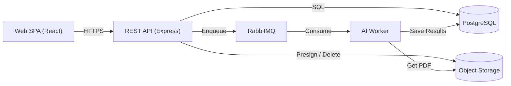
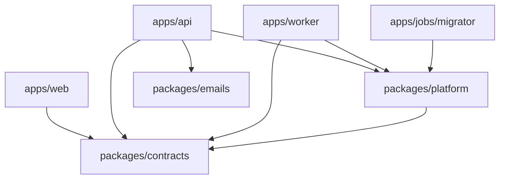
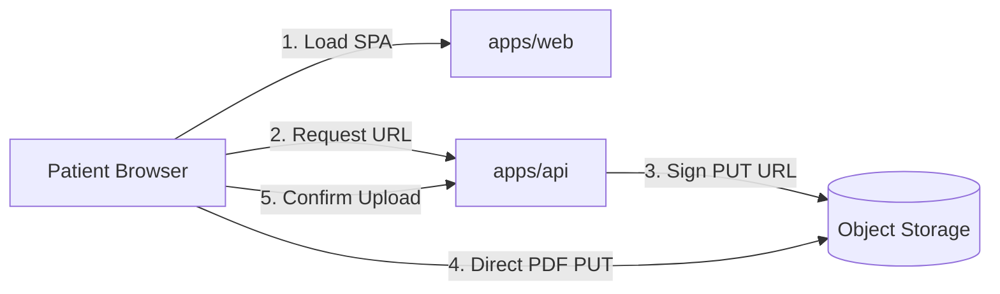
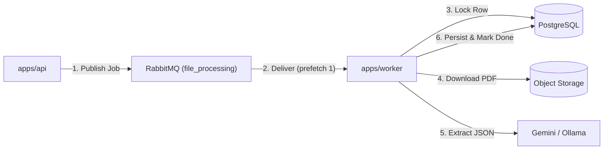
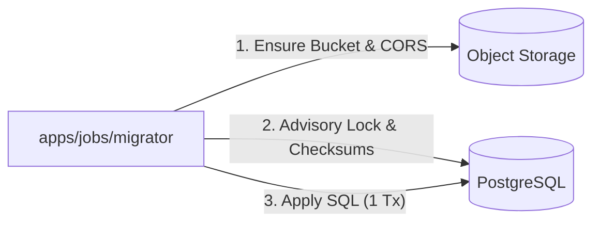

# Containers, Dependencies & Flows (C4 Level 2)

Health Vitals is a Bun Workspace monorepo with four runnable containers (`apps/*`) and three internal shared packages (`packages/*`). Each diagram below isolates a single architectural concern.

---

## 1. High-Level Runtime Containers

Live services and data stores interacting at runtime.

*(External SaaS calls: `REST API` sends emails via Resend; `AI Worker` calls Google Gemini or local Ollama.)*

---

## 2. Workspace Package Dependencies (Compile-Time)

Internal Bun Workspace dependency DAG. Applications never import from one another, and all cross-workspace imports use declared package exports only.

---

## 3. Frontend & Direct Upload Flow

How the browser loads the SPA, requests signed URLs, streams PDFs directly to object storage, and confirms uploads.

---

## 4. Backend Async Extraction Flow

How confirmed uploads are processed idempotently in the background without blocking HTTP requests.

---

## 5. Migration & Bootstrap Flow

Run-once job executed prior to releasing new `api` or `worker` versions.

---

## Container & Package Specifications

| Container / Package | Runtime Role | Key Contracts & Implementation Details |
| :--- | :--- | :--- |
| **`apps/web`** | React 19 + Vite 8 + Tailwind 4 SPA (`Recharts`, `GSAP`, `i18next`). | Uses native `fetch` wrapper (`src/api/client.ts`), MSW mock mode (`dev:mock`), and direct presigned PUT uploads. |
| **`apps/api`** | Express 5 REST API (`auth`, `files`, `reports`, `dashboard`, `health`, `docs`). | Argon2id + JWT access / HttpOnly refresh cookies; serves OpenAPI 3.0.3 at `/openapi.json` and Swagger UI at `/docs`; publishes `FileProcessJobPayload`. |
| **`apps/worker`** | Headless RabbitMQ consumer (`prefetch = 1`). | Locks `files` row with `SELECT ... FOR UPDATE`, skips non-`QUEUED` rows, transitions atomically to `PROCESSING`, extracts text (`pdf-parse`, min 50 chars), checks `llm_requests` rate limits, invokes `LLMProvider`, persists `reports` + `observations`, marks `SUCCEEDED` or `FAILED_*`. |
| **`apps/jobs/migrator`** | Run-once pre-deploy schema & bucket initializer. | Acquires `pg_advisory_xact_lock(1769100000000)`, verifies SHA-256 checksums of applied migrations, applies pending SQL in one `BEGIN ... COMMIT` transaction, ensures bucket + CORS. |
| **`packages/contracts`** | Pure declarative leaf package (zero internal workspace dependencies). | Single source of truth for Zod v4 schemas, enums (`FileStatus`, `ExamExtractionModel`), DTO types, and OpenAPI schema generation. |
| **`packages/platform`** | Infrastructure abstraction layer (`Database`, `Queue`, `StorageClient`, `MailProvider`, `LLMProvider`, `Logger`, `AppError`, `env.ts`). | Centralizes external SDKs and fail-fast startup environment validation. |
| **`packages/emails`** | Branded transactional email templates (React Email v6). | Rendered by `apps/api` into HTML + plain-text fallbacks for email verification and password recovery. |
