# Dependencies & Testing Strategy

This document records the rationale behind Health Vitals' core technology selections and its testing pyramid.

## 1. Dependencies & Libraries

### Runtime, Tooling & Build System

| Package / Tool | Workspace Scope | Architectural Role & Rationale |
| :--- | :--- | :--- |
| **[Bun](https://bun.sh/)** (`^1.3`) | Root / All | Single runtime, package manager, native TypeScript executor, and fast built-in test runner (`bun:test`). |
| **[@biomejs/biome](https://biomejs.dev/)** (`^2.4`) | Root Dev | Unified Rust linter and formatter replacing ESLint + Prettier with sub-second execution across the monorepo (including Tailwind v4 `tailwindDirectives`). |
| **[TypeScript](https://www.typescriptlang.org/)** (`^6.0`) | All Workspaces | Strict type checking (`bun run typecheck`); no `any` in new code. |

### Backend, Platform & Emails

| Dependency | Location | Role & Rationale |
| :--- | :--- | :--- |
| **`express` (`^5.1`)** | `apps/api` | Native async error forwarding in Express 5 without manual wrapper boilerplate. |
| **`swagger-ui-express` (`^5.0`)** | `apps/api` | Offline-capable Swagger UI at `/docs` consuming Zod-generated `/openapi.json`. |
| **`zod` (`^4.3`–`^4.4`)** | `contracts`, `platform`, `api`, `worker` | Single source of truth for runtime validation, TypeScript type inference, and native OpenAPI 3.0 JSON Schema generation (`z.toJSONSchema`). |
| **`pg` (`^8.16`)** | `packages/platform`, `apps/jobs/migrator` | Pooled PostgreSQL access, row-level locking (`SELECT ... FOR UPDATE`), and transaction-scoped advisory locks (`pg_advisory_xact_lock`). |
| **`amqplib` (`^1.0`)** | `packages/platform` | AMQP 0-9-1 client for durable `file_processing` queue publishing/consumption with `prefetch = 1`. |
| **`@aws-sdk/client-s3` & `s3-request-presigner`** | `packages/platform`, `apps/jobs/migrator` | S3-compatible client targeting MinIO locally and Neon Object Storage in production; presigned PUT URLs keep binary uploads off the API server. |
| **`@google/genai` (`^1.0`)** | `packages/platform`, `apps/worker` | Google Gemini AI Studio SDK for structured clinical extraction alongside `OllamaProvider` (local) and `MockLLMProvider` (CI/tests). |
| **`argon2` (`^0.44`) & `jsonwebtoken` (`^9.0`)** | `apps/api` | Memory-hard Argon2id password/token hashing plus short-lived JWT access tokens + HttpOnly `SameSite=Strict` refresh cookies. |
| **`pino` (`^10.1`) & `pino-http` (`^11.0`)** | `packages/platform`, `apps/api` | Low-overhead structured JSON logging to `stdout`. |
| **`pdf-parse` (`^2.4`)** | `apps/worker`, `apps/api` | In-memory PDF text extraction without native Poppler binaries. |
| **`resend` (`^6.8`), `nodemailer` (`^8.0`), `react-email` (`^6.11`)** | `packages/platform`, `packages/emails` | Branded transactional emails with swappable `MailProvider` (Resend in prod, Nodemailer/Mock locally). |

### Frontend Ecosystem (`apps/web`)

| Dependency | Role & Rationale |
| :--- | :--- |
| **`react` (`^19.2`) + `vite` (`^8.0`) + `tailwindcss` (`^4.1`)** | Modern SPA stack with Vite native Tailwind plugin and fast HMR. |
| **`react-router-dom` (`^7.12`)** | Client routing and protected route wrappers. |
| **`recharts` (`^3.6`) & `gsap` (`^3.14`)** | Clinical biomarker trend charts with reference-range shading and SVG animations. |
| **`i18next` & `react-i18next`** | Synchronized multi-locale UI copy (`src/locales/`). |
| **`lucide-react` + `clsx` + `tailwind-merge`** | Tree-shakeable icons and safe class merging. |
| **`msw` (`^2.12`)** | Network-layer Mock Service Worker (`bun --filter @health-vitals/web dev:mock`) for zero-backend frontend development. |

---

## 2. Testing Pyramid & Strategy

All automated tests run via Bun's native runner (`bun test`):

```text
         / \
        /E2E\          tests/e2e/system.e2e.test.ts (RUN_E2E=true, native Bun fetch)
       /-----\
      /Integr.\        apps/*/tests/integration/ (Supertest + real PostgreSQL & RabbitMQ)
     /---------\
    /Unit Tests \      Co-located *.test.ts / *.unit.test.ts (contracts, platform, emails, API docs, PDF parser)
   /-------------\
```

- **Unit Tests:** Co-located next to source files and under `packages/*/tests/`. Fast, deterministic, zero external infrastructure required (`bun test packages/` and `bun test apps/api/src/docs/openapi.test.ts`).
- **Integration Tests:** Run against real PostgreSQL and RabbitMQ containers (local `compose.yml` or GitHub Actions services) using Supertest in-memory Express invocations (`createApp()`) and cascading user teardown (`ON DELETE CASCADE`).
- **AI / LLM Testing:** CI and default integration tests use `MockLLMProvider` for zero-cost deterministic output. Live Gemini API extraction tests are explicitly gated:
  ```bash
  RUN_LLM_TESTS=true bun test --env-file=../../.env tests/integration/process-file.test.ts
  ```
- **End-to-End Tests:** `bun run test:e2e` (`RUN_E2E=true`) executes [`tests/e2e/system.e2e.test.ts`](../../tests/e2e/system.e2e.test.ts) using native Bun `fetch` against a running Docker Compose stack.

---

## 3. Continuous Integration Quality Gates

Defined in [`.github/workflows/ci.yml`](../../.github/workflows/ci.yml) on every push and pull request to `main`:

```mermaid
flowchart LR
    Checkout["1. Checkout & Setup Bun"] --> Install["2. bun install --frozen-lockfile"]
    Install --> Lint["3. bun run lint (Biome)"]
    Lint --> InfraCheck["4. bun run infra:check"]
    InfraCheck --> Typecheck["5. bun run typecheck (tsc)"]
    Typecheck --> Migrate["6. bun run migration:run"]
    Migrate --> Test["7. bun run test (Unit + Integration)"]
    Test --> Build["8. Docker Build Verification (main only)"]
```


