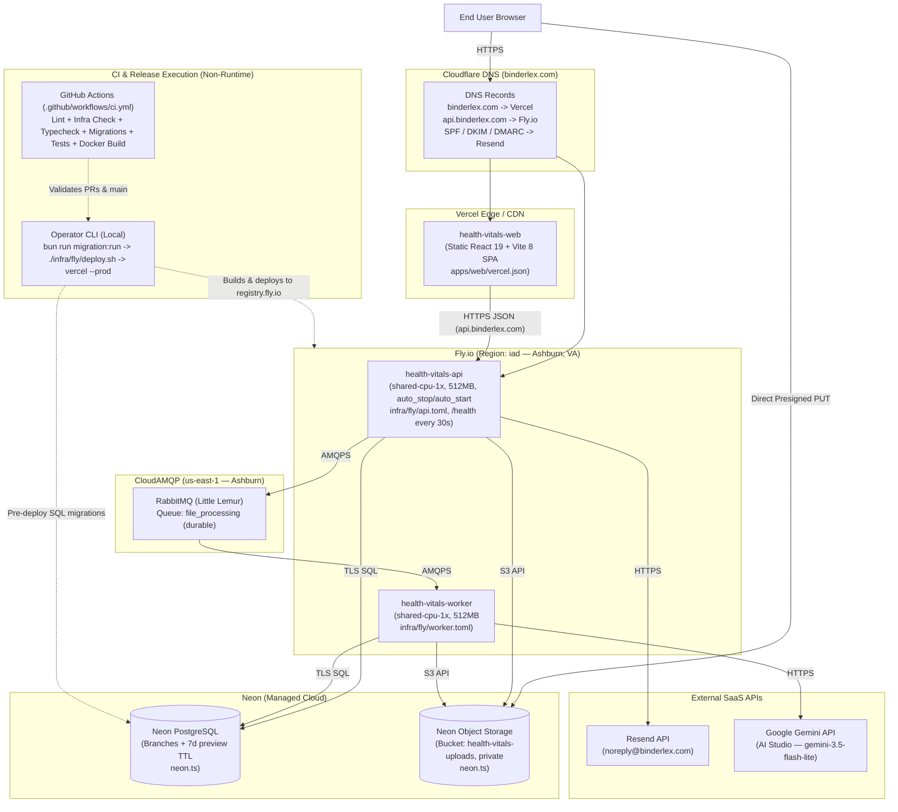
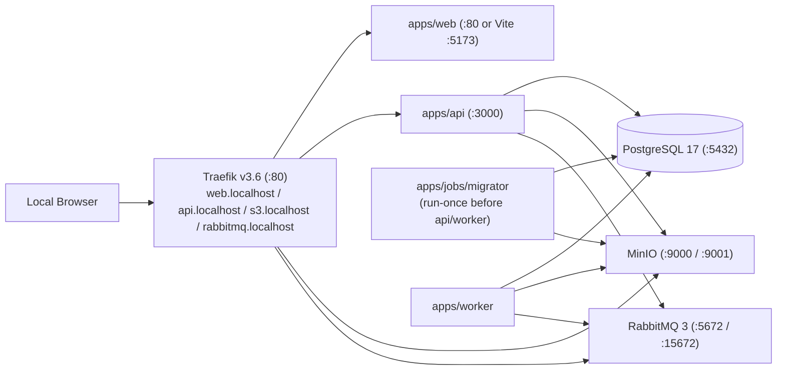

# Deployment Topology (C4 Deployment)

Health Vitals runs in two distinct topologies: a **local Docker Compose stack** for self-contained development and integration testing, and a **zero-VPS Split Managed Stack** in production.

## Production Topology (Split Managed Stack)

## Local Development Topology (`compose.yml`)

## Environment Differences

| Aspect | Local Development (`compose.yml`) | Production (Split Managed Stack) |
| :--- | :--- | :--- |
| **Ingress / TLS** | Traefik v3.6 HTTP (`*.localhost`) | Cloudflare DNS + Vercel TLS (`binderlex.com`) + Fly.io Let's Encrypt TLS (`api.binderlex.com`) |
| **PostgreSQL** | Docker `postgres:17-alpine` | Neon Serverless PostgreSQL (`sslmode=require`) |
| **Object Storage** | Docker `minio/minio` | Neon Object Storage (`health-vitals-uploads`, private) |
| **Message Broker** | Docker `rabbitmq:3-management-alpine` (`amqp://`) | CloudAMQP Little Lemur (`amqps://`) |
| **Backend Hosting** | Local Bun watch or Docker Compose | Fly.io (`iad`): `health-vitals-api` & `health-vitals-worker` |
| **Frontend Hosting** | Vite dev server (`:5173`) or MSW `dev:mock` | Vercel CDN (`apps/web`) |
| **Email & LLM** | Mock/Nodemailer + Mock/Ollama/Gemini | Resend (`noreply@binderlex.com`) + Google Gemini AI Studio |
| **Image Registry** | Local Docker daemon | Fly.io internal registry (`registry.fly.io`); Docker Hub optional mirror only |
