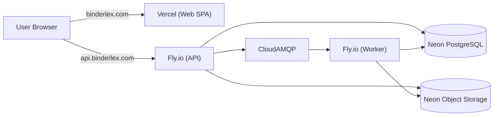
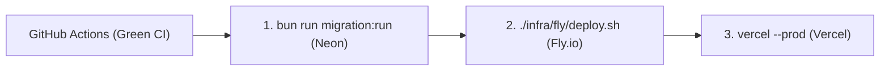
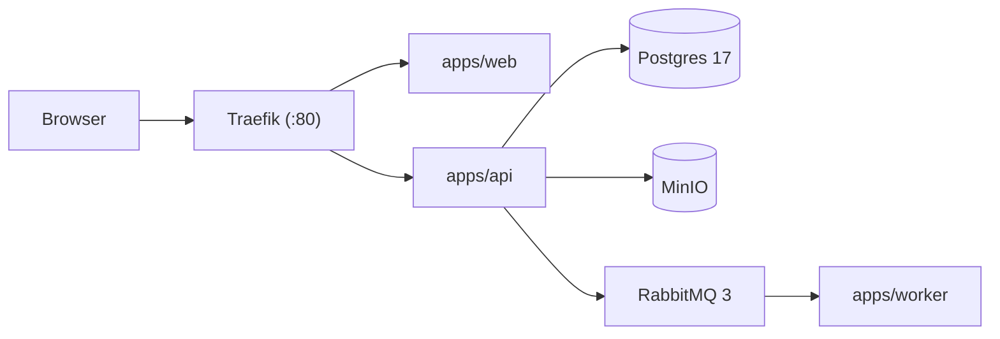

# Deployment Topology (C4 Deployment)

Health Vitals runs in two topologies: a **zero-VPS Split Managed Stack** in production and a self-contained **Docker Compose stack** for local development and integration testing.

---

## 1. Production Runtime Hosting (Split Managed Stack)

Live traffic and background processing across managed cloud providers.

*(External SaaS integrations not shown to keep arrows clean: **Cloudflare DNS** resolves `binderlex.com` / `api.binderlex.com`; **Fly.io API** sends transactional email via **Resend**; **Fly.io Worker** calls **Google Gemini AI Studio**.)*

---

## 2. Production Deploy Pipeline

Ordered release sequence ensuring forward-only schema migrations run before new backend containers roll out.

---

## 3. Local Development Stack (`compose.yml`)

Self-contained local stack for development and integration tests.

*(In Docker Compose, `apps/jobs/migrator` runs once after `postgres` is healthy and before `api` and `worker` start.)*

---

## Environment Comparison

| Aspect | Local Development (`compose.yml`) | Production (Split Managed Stack) |
| :--- | :--- | :--- |
| **Ingress / TLS** | Traefik v3.6 HTTP (`*.localhost`) | Cloudflare DNS + Vercel TLS (`binderlex.com`) + Fly.io Let's Encrypt (`api.binderlex.com`) |
| **PostgreSQL** | Docker `postgres:17-alpine` | Neon Serverless PostgreSQL (`sslmode=require`, 7d preview branch TTL in `neon.ts`) |
| **Object Storage** | Docker `minio/minio` | Neon Object Storage (`health-vitals-uploads` private bucket in `neon.ts`) |
| **Message Broker** | Docker `rabbitmq:3-management-alpine` (`amqp://`) | CloudAMQP Little Lemur in `us-east-1` (`amqps://`, durable queue `file_processing`) |
| **Backend Compute** | Local Bun watch or Docker Compose | Fly.io `iad`: `health-vitals-api` (`shared-cpu-1x`, 512 MB, auto-stop/start, `/health` 30s) & `health-vitals-worker` (`shared-cpu-1x`, 512 MB) |
| **Frontend Hosting** | Vite dev server (`:5173`) or MSW `dev:mock` | Vercel CDN (`apps/web/vercel.json`) |
| **Email & LLM** | Mock / Nodemailer + Mock / Ollama / Gemini | Resend (`noreply@binderlex.com`) + Google Gemini AI Studio (`gemini-3.5-flash-lite`) |
| **Image Registry** | Local Docker daemon | Fly.io internal registry (`registry.fly.io`); Docker Hub optional mirror only |
