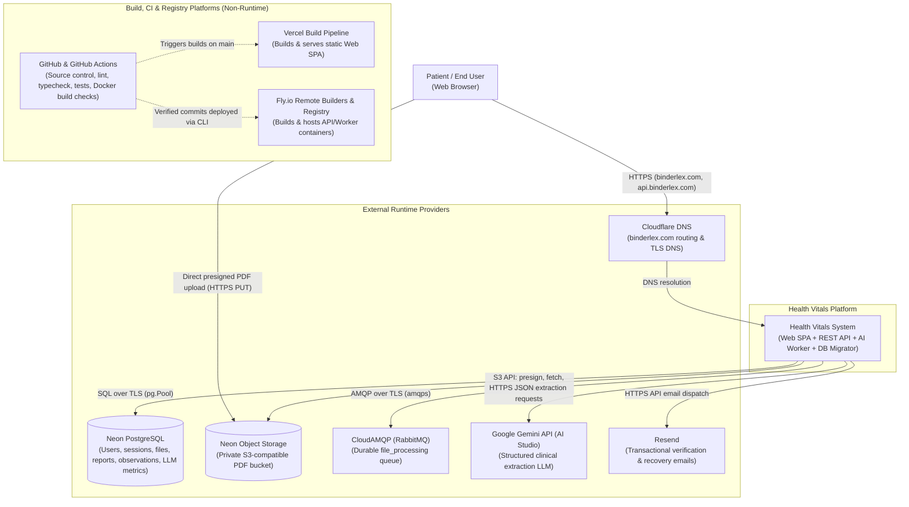

# System Context (C4 Level 1)

Health Vitals enables patients to upload clinical laboratory reports (PDF), automatically extract structured biomarker measurements using generative AI, and track longitudinal health trends across clinical panels (lipid panel, glucose metabolism, renal function).

## Context Diagram

The diagram below distinguishes **runtime external dependencies** from **delivery/CI platforms** (which build, test, and deploy the system but are not called at request time).

## Key Boundaries

- **Direct Browser-to-Storage Data Plane:** After authenticating with the API and requesting a presigned PUT URL, the user's browser streams PDF bytes directly to Neon Object Storage (`health-vitals-uploads` private bucket), keeping binary uploads out of the API process.
- **Asynchronous Extraction Decoupling:** Confirming an upload enqueues a job in CloudAMQP and returns immediately (`200 OK`, status `QUEUED`). The background worker downloads the PDF, parses text, enforces model rate limits, invokes Google Gemini, and commits normalized biomarkers to Neon PostgreSQL.
- **Non-Runtime Tooling Separation:** GitHub Actions, Vercel builds, Fly.io remote builders/registry, and Docker Hub (optional archival mirror) are **not** runtime dependencies—if GitHub is down, live users can still log in, upload PDFs, and view dashboards.
