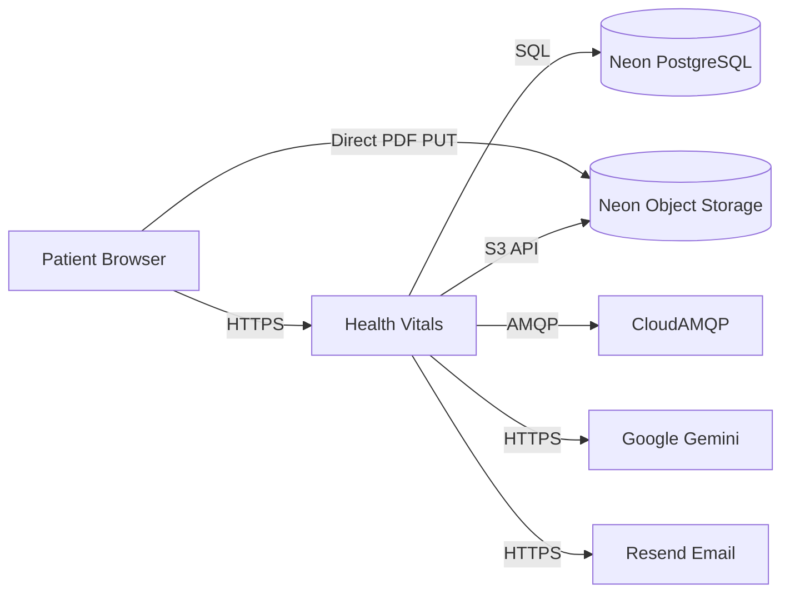
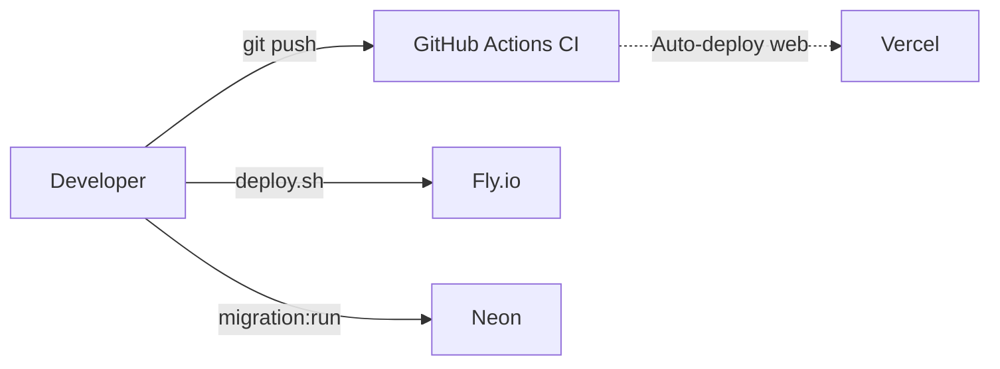

# System Context (C4 Level 1)

Health Vitals enables patients to upload clinical laboratory reports (PDF), automatically extract structured biomarker measurements using generative AI, and track longitudinal health trends across clinical panels (lipid panel, glucose metabolism, renal function).

## 1. Runtime System Context

Live external systems contacted during user requests and background extraction. (Cloudflare DNS resolves `binderlex.com` and `api.binderlex.com` at the edge.)

## 2. Delivery & CI Context (Non-Runtime)

Source control, CI verification, and deployment tooling. None of these are called on the live request path—if GitHub is unavailable, live traffic continues unaffected.

## Key Boundaries

| Boundary | Behavior |
| :--- | :--- |
| **Edge DNS (Cloudflare)** | Routes `binderlex.com` to Vercel, `api.binderlex.com` to Fly.io, and hosts Resend SPF/DKIM/DMARC records ([`infra/dns/README.md`](../../infra/dns/README.md)). |
| **Direct Browser-to-Storage Upload** | After requesting a presigned PUT URL from the API, the browser streams PDF bytes directly to Neon Object Storage (`health-vitals-uploads` private bucket), keeping binary uploads out of API memory. |
| **Async Extraction Decoupling** | Upload confirmation enqueues a job in CloudAMQP and returns `200 OK` (`QUEUED`). The worker processes PDF parsing and Gemini extraction asynchronously. |
| **Non-Runtime Tooling** | GitHub Actions, Fly.io remote builders/registry, Vercel builds, and Docker Hub (optional archival mirror) operate strictly at build/deploy time. |
